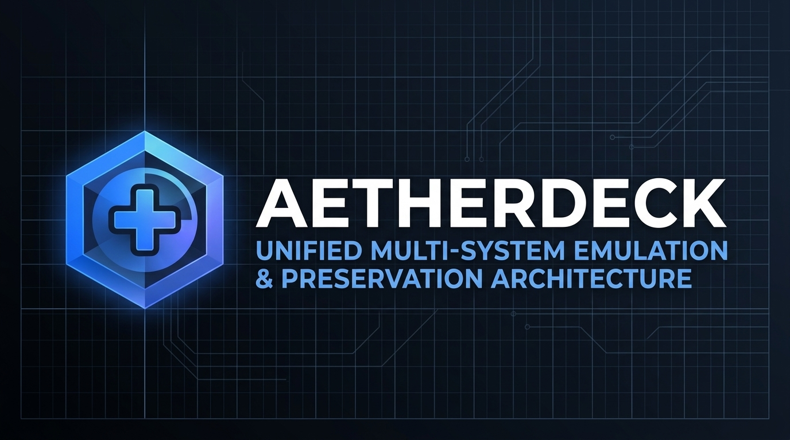
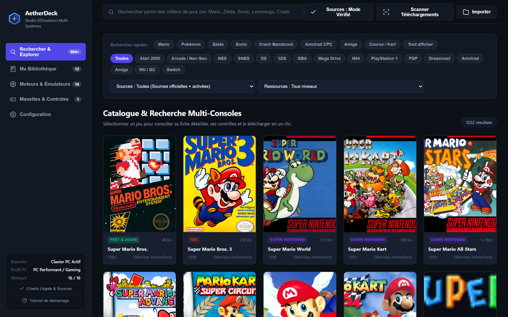
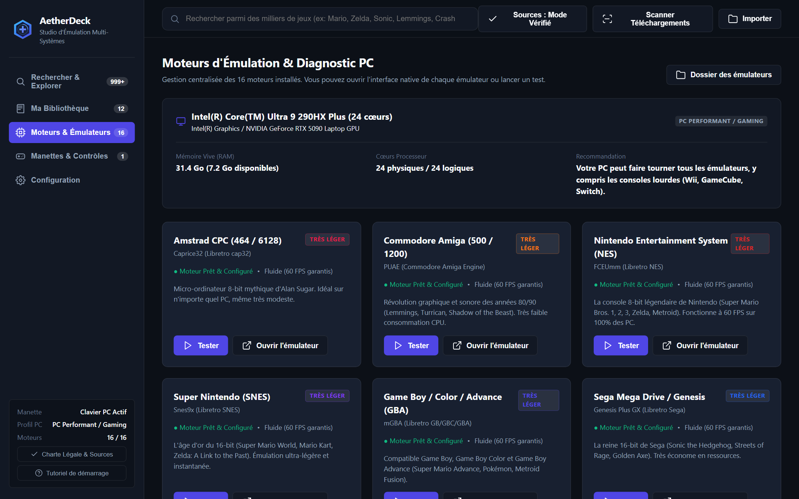
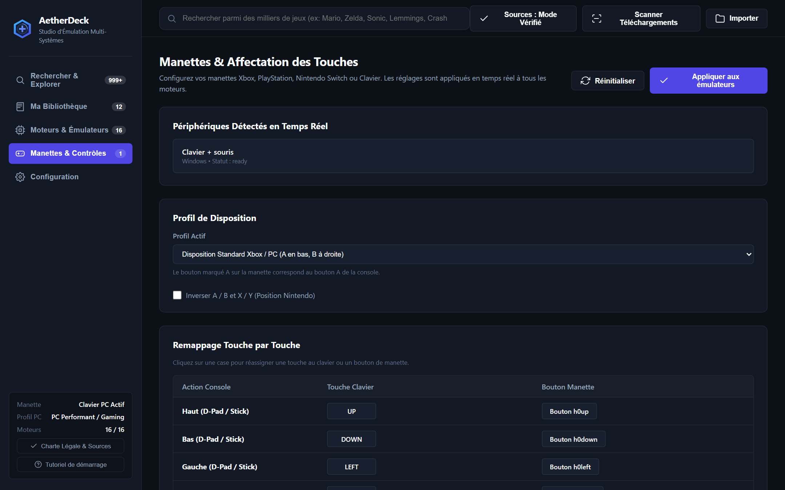
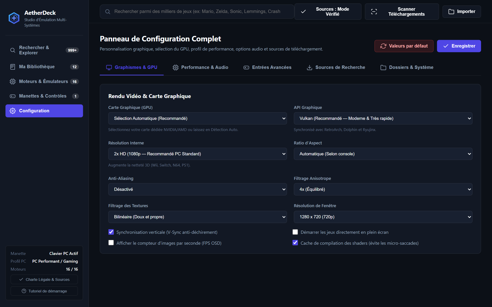
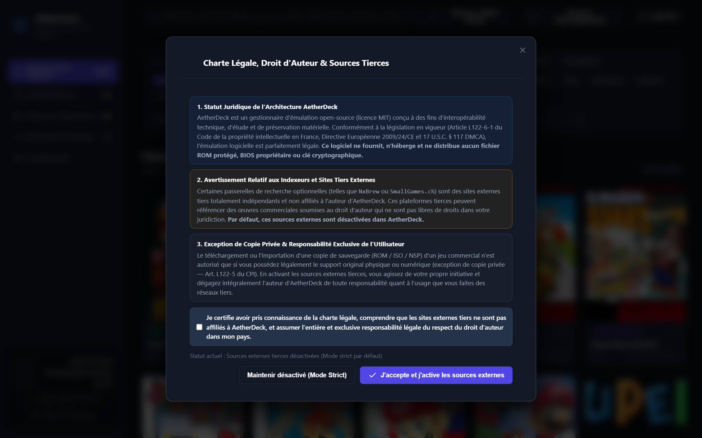
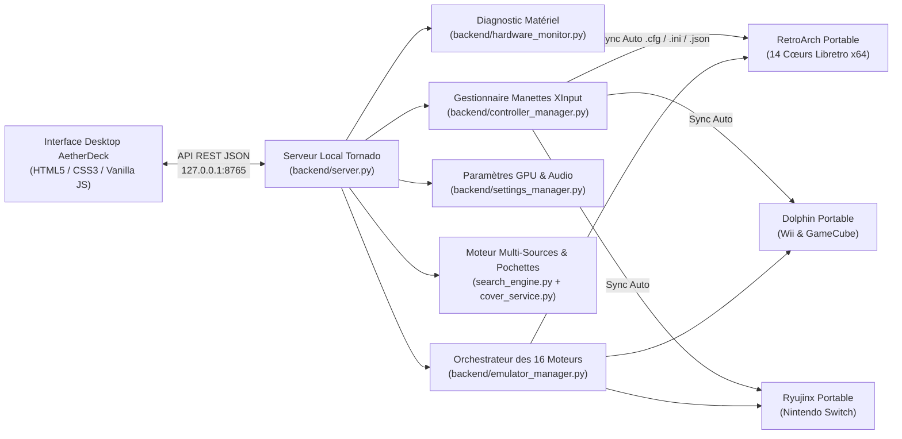

<div align="center">



<br />

# AetherDeck

### Architecture Unifiée d'Émulation, d'Orchestration Matérielle & de Préservation Multi-Systèmes

[](LICENSE)
[](#installation--demarrage-rapide)
[](#matrice-des-16-consoles--moteurs-integres)
[](#fonctionnalites-techniques)
[](LEGAL.md)

<p align="center">
  <strong>AetherDeck</strong> est une station d'émulation de bureau moderne pour Windows 10/11 qui fédère <strong>16 consoles et micro-ordinateurs historiques</strong> (de l'Atari 2600 et l'Amstrad CPC jusqu'à la Nintendo Wii, la PlayStation Portable, la Sega Dreamcast et la Nintendo Switch) au sein d'une interface unique, sans publicité, avec synchronisation automatique des manettes (Xbox, PlayStation, Switch Pro, Clavier) et provisionnement légal des moteurs en un clic.
</p>

<p align="center">
  <a href="#apercu-visuel-de-linterface">Aperçu Visuel</a> •
  <a href="#matrice-des-16-consoles--moteurs-integres">16 Consoles Supportées</a> •
  <a href="#fonctionnalites-techniques">Fonctionnalités</a> •
  <a href="#installation--demarrage-rapide">Installation</a> •
  <a href="#architecture-du-projet">Architecture</a> •
  <a href="#cadre-legal--droit-dauteur">Cadre Légal (DMCA / CPI)</a>
</p>

</div>

---

## Aperçu Visuel de l'Interface

### 1. Catalogue Multi-Consoles & Recherche Unifiée
Recherche instantanée à travers les 16 architectures avec récupération automatique des jaquettes haute définition (Europe, USA, World, Japan) et filtrage par console, source ou niveau de ressources matérielles.



### 2. Gestionnaire des 16 Moteurs d'Émulation & Diagnostic Matériel PC
Analyse automatique du processeur (CPU), de la mémoire vive (RAM) et des cartes graphiques (GPU dédiés NVIDIA/AMD ou iGPU) pour recommander les réglages optimaux et vérifier l'état des 16 moteurs portables.



### 3. Centre de Contrôle des Manettes & Remappage Touche par Touche
Détection en temps réel via l'API Windows XInput et HTML5 Gamepad, test de vibration matériel, inversion instantanée des boutons `A/B` et `X/Y` (profil Xbox vers Nintendo) et table interactive de réassignation touche par touche.



### 4. Panneau de Configuration Graphique, GPU & Audio
Sélection explicite du GPU, choix de l'API de rendu (`Vulkan`, `Direct3D 11`, `Direct3D 12`, `OpenGL`), mise à l'échelle de la résolution interne (`1x` 720p jusqu'à `4x` 4K Ultra HD), anti-aliasing (`MSAA` / `FXAA`), filtrage anisotrope (`16x`) et profil énergétique (`Mode Éco PC Léger` à `Haute Performance`).



### 5. Charte Légale Intégrée & Consentement Utilisateur
Protection juridique native : les dépôts homebrew officiels et archives publiques sont activés par défaut en HTTPS sécurisé, tandis que les indexeurs externes tiers sont désactivés par défaut et soumis à l'acceptation explicite de la charte de responsabilité par l'utilisateur.



---

## Matrice des 16 Consoles & Moteurs Intégrés

Tous les moteurs sont téléchargés et configurés automatiquement en mode **100 % portable** via le script [`setup_engines.py`](setup_engines.py) depuis les dépôts officiels amont (Libretro Buildbot, Dolphin Emulator et archives officielles).

| Système / Console | Année | Moteur / Cœur d'Émulation | Formats Supportés | Catégorie PC | Catalogue & Dépôt Intégré |
| :--- | :---: | :--- | :--- | :---: | :--- |
| **Atari 2600 (VCS)** | 1977 | Libretro **Stella 2014** (`stella2014_libretro.dll`) | `.a26`, `.bin`, `.zip` | Léger | Internet Archive (`atari-2600-roms-ultra`) |
| **Arcade & SNK Neo Geo** | 1990 | Libretro **FinalBurn Neo** (`fbneo_libretro.dll`) | `.zip`, `.7z` | Léger | Internet Archive (`neo-geo-aes-romset`) |
| **Amstrad CPC 464 / 6128** | 1984 | Libretro **Caprice32** (`cap32_libretro.dll`) | `.dsk`, `.sna`, `.cdt`, `.zip` | Léger | Internet Archive (`Amstrad_CPC_TOSEC`) |
| **Commodore Amiga 500 / 1200** | 1987 | Libretro **PUAE** (`puae_libretro.dll`) | `.adf`, `.ipf`, `.lha`, `.hdf`, `.zip` | Léger | Internet Archive (`Commodore_Amiga_TOSEC`) |
| **Nintendo Entertainment System (NES)** | 1985 | Libretro **FCEUmm** (`fceumm_libretro.dll`) | `.nes`, `.fds`, `.zip` | Léger | Internet Archive (`nes-romset-ultra`) |
| **Super Nintendo (SNES)** | 1990 | Libretro **Snes9x** (`snes9x_libretro.dll`) | `.sfc`, `.smc`, `.zip` | Léger | Internet Archive (`snes-romset-ultra`) |
| **Game Boy Advance (GBA)** | 2001 | Libretro **mGBA** (`mgba_libretro.dll`) | `.gba`, `.gb`, `.gbc`, `.zip` | Léger | Internet Archive (`gba-romset-ultra`) |
| **Nintendo DS (NDS)** | 2004 | Libretro **melonDS** (`melonds_libretro.dll`) | `.nds`, `.dsi`, `.zip` | Léger | Internet Archive (`no-intro-nintendo-nintendo-ds-decrypted`) |
| **Sega Mega Drive / Genesis** | 1988 | Libretro **Genesis Plus GX** (`genesis_plus_gx_libretro.dll`) | `.md`, `.gen`, `.smd`, `.bin`, `.zip` | Léger | Internet Archive (`sega-genesis-romset-ultra`) |
| **Nintendo 64 (N64)** | 1996 | Libretro **Mupen64Plus-Next** (`mupen64plus_next_libretro.dll`) | `.z64`, `.n64`, `.v64`, `.zip` | Moyen | Internet Archive (`n64-romset-ultra`) |
| **Sony PlayStation (PS1)** | 1994 | Libretro **SwanStation** (`swanstation_libretro.dll`) | `.chd`, `.cue`, `.bin`, `.iso`, `.pbp` | Moyen | Internet Archive (`chd_psx`) |
| **Sony PlayStation Portable (PSP)** | 2004 | Libretro **PPSSPP** (`ppsspp_libretro.dll`) | `.iso`, `.cso`, `.chd`, `.pbp` | Moyen | Internet Archive (`psp-chd-zstd-redump-part1`) |
| **Sega Dreamcast** | 1998 | Libretro **Flycast** (`flycast_libretro.dll`) | `.chd`, `.cdi`, `.gdi` | Moyen | Internet Archive (`DreamcastSelfBoot`) |
| **Nintendo 3DS** | 2011 | Libretro **Citra** (`citra_libretro.dll`) | `.3ds`, `.cci`, `.cxi`, `.cia`, `.app` | Moyen | Internet Archive (`3ds-decrypted-v2`) |
| **Nintendo Wii & GameCube** | 2006 | **Dolphin Standalone Portable** & `dolphin_libretro.dll` | `.rvz`, `.wbfs`, `.iso`, `.gcm`, `.dol` | Lourd | Open Shop Channel (299 Homebrews) & Internet Archive (`rvz-gc-usa-redump`) |
| **Nintendo Switch** | 2017 | **Ryujinx Standalone Portable** (`Ryujinx.exe` 1.3.3) | `.nsp`, `.xci`, `.nro`, `.nca` | Lourd | Switch Homebrew App Store (189 Homebrews) & Passerelle Externe Optionnelle |

---

## Fonctionnalités Techniques

### 1. Orchestration Portable & Zéro Pollution du Système Windows
- **Isolation Portable Complète** : Tous les moteurs (`RetroArch`, `Dolphin`, `Ryujinx`), leurs fichiers de configuration (`.cfg`, `.ini`, `Config.json`) et leurs sauvegardes résident exclusivement dans le dossier local `emulators/`. Aucune clé de registre Windows ni aucun dossier système `%APPDATA%` externe n'est altéré.
- **Lancement Intelligent & Auto-Run** :
  - **Amstrad CPC** : Analyse automatique du catalogue secteur des disquettes `.dsk` pour détecter le binaire amorçable et injecter la commande `RUN"..."` automatiquement au démarrage.
  - **Nintendo Wii / GameCube** : Sélection dynamique entre le cœur Libretro et Dolphin Standalone (`Dolphin.exe -b -e`) pour une compatibilité maximale avec les formats compressés sans perte `.rvz`.
  - **Nintendo Switch** : Configuration portable automatisée de `Ryujinx.exe` (`-r emulators/switch/portable`), prise en charge directe des formats `.nsp`, `.xci` et `.nro`, et vérification automatique de l'état du micrologiciel système.

### 2. Synchronisation Universelle des Manettes (XInput & SDL2)
- Dès qu'un profil de contrôle est modifié dans l'onglet **Manettes**, [`backend/controller_manager.py`](backend/controller_manager.py) régénère instantanément :
  - `emulators/retroarch/retroarch.cfg` (affectations clavier et manette XInput, zones mortes, vibration) ;
  - `emulators/dolphin/User/Config/GCPadNew.ini` et `WiimoteNew.ini` (GameCube, Wiimote + Nunchuk, Wiimote Horizontale ou Classic Controller) ;
  - `emulators/switch/portable/Config.json` (Switch Pro Controller, paire de Joy-Cons ou mode Portable).

### 3. Moteur Automatique de Pochettes Haute Définition (`CoverService`)
- Lorsqu'un jeu ne possède pas de jaquette locale, [`backend/cover_service.py`](backend/cover_service.py) normalise le titre, interroge en arrière-plan le CDN officiel `thumbnails.libretro.com` à travers toutes les régions (`Europe`, `USA`, `World`, `Japan`, `France`) avec correspondance floue (*fuzzy matching*), met l'image en cache sur le disque dans `data/covers/`, et génère une pochette vectorielle SVG sur mesure en cas de titre homebrew inédit.

### 4. Sécurité Réseau & Extraction Automatique d'Archives
- Tous les téléchargements issus des dépôts intégrés s'effectuent en **HTTPS vérifié** avec suivi en temps réel de la vitesse (`Mo/s`), de la progression (`%`) et extraction automatique des archives `.zip`, `.rar` et `.7z` vers le sous-dossier `roms/<console>/` correspondant.

---

## Installation & Démarrage Rapide

### Prérequis
- **Système d'exploitation** : Windows 10 ou Windows 11 (64 bits)
- **Python** : Python 3.10 ou supérieur ([python.org](https://www.python.org/downloads/))
- **Connexion Internet** : Requise lors du premier lancement de [`setup_engines.py`](setup_engines.py) pour télécharger les moteurs portables officiels.

### Installation en 3 Commandes

```powershell
# 1. Cloner le dépôt GitHub
git clone https://github.com/Titi0378/AetherDeck.git
cd AetherDeck

# 2. Installer les dépendances Python et provisionner automatiquement les 16 moteurs d'émulation
python -m pip install -r requirements.txt
python -m playwright install chromium
python setup_engines.py

# 3. Lancer l'application de bureau AetherDeck
python main.py
```

### Lancement en Un Clic sous Windows (Fichiers `.bat`)
- Double-cliquez sur **[`Installer_Moteurs.bat`](Installer_Moteurs.bat)** lors de la première installation pour installer les bibliothèques et télécharger automatiquement RetroArch, les 16 cœurs Libretro, Dolphin Portable et Ryujinx Portable.
- Double-cliquez ensuite sur **[`Lancer_AetherDeck.bat`](Lancer_AetherDeck.bat)** pour démarrer l'interface graphique native.

---

## Architecture du Projet



### Arborescence des Fichiers

```text
AetherDeck/
├── main.py                      # Point d'entrée principal et lanceur de fenêtre native Windows
├── setup_engines.py             # Script d'installation automatique des 16 moteurs officiels
├── requirements.txt             # Dépendances Python (tornado, requests, playwright)
├── Lancer_AetherDeck.bat        # Raccourci de démarrage Windows en un clic
├── Lancer_AetherDeck.vbs        # Raccourci de démarrage silencieux Windows
├── LEGAL.md                     # Charte juridique complète (CPI Art. L122-5 / DMCA)
├── LICENSE                      # Licence Open-Source MIT
├── backend/
│   ├── server.py                # Serveur HTTP Tornado et routes API REST (/api/*)
│   ├── hardware_monitor.py      # Spécifications des 16 consoles et détection CPU/GPU/RAM
│   ├── emulator_manager.py      # Téléchargement, configuration et exécution des 16 moteurs
│   ├── controller_manager.py    # Détection XInput temps réel et génération des profils manettes
│   ├── settings_manager.py      # Gestion GPU, Vulkan/Direct3D, résolution, audio et consentement légal
│   ├── search_engine.py         # Moteur de recherche multi-sources, téléchargement et extraction
│   ├── game_catalog.py          # Catalogues vérifiés et collections Internet Archive (16 consoles)
│   └── cover_service.py         # Recherche automatique et cache local des pochettes HD
├── frontend/
│   ├── index.html               # Interface utilisateur complète (5 vues + modale légale)
│   ├── styles.css               # Design System sombre haute précision (sans emojis, icônes SVG)
│   ├── app.js                   # Logique cliente, remappage temps réel et suivi des tâches
│   ├── logo.svg                 # Logo vectoriel officiel AetherDeck
│   └── logo.png                 # Logo matriciel haute résolution
├── docs/
│   ├── assets/                  # Bannière 16:9 et logos officiels pour GitHub
│   └── screenshots/             # Captures d'écran haute définition de l'interface
└── tests/
    ├── test_aetherdeck.py       # Suite de tests unitaires et d'intégration API (16 tests)
    ├── test_launch_process.py   # Vérification du lancement réel des processus d'émulation
    └── verify_frontend.py       # Audit automatisé Playwright du DOM et absence d'erreurs
```

---

## Tests & Vérification Qualité

Pour exécuter la suite complète de tests automatisés (vérification des 16 consoles, de la génération des configurations manettes, de la conformité de l'interface et du lancement des moteurs) :

```powershell
python tests/test_aetherdeck.py
python tests/test_launch_process.py
python tests/verify_frontend.py
```

---

## Cadre Légal & Droit d'Auteur

Ce projet respecte scrupuleusement le **Code de la propriété intellectuelle** (Articles L122-5 et L122-6-1), la **Directive Européenne 2009/24/CE** et le **Digital Millennium Copyright Act (17 U.S.C. § 117)** :

1. **Aucun fichier sous droit d'auteur inclus** : Ce dépôt GitHub ne contient **aucun jeu commercial (ROM / ISO / NSP)**, **aucun BIOS propriétaire**, **aucun firmware** et **aucune clé cryptographique (`prod.keys` / `title.keys`)**.
2. **Désactivation par défaut des sources tierces** : Les passerelles de recherche vers des sites tiers externes indépendants sont **désactivées par défaut** dans le code source. Leur activation éventuelle requiert le consentement explicite de l'utilisateur via la modale juridique intégrée, sous son entière et exclusive responsabilité.
3. **Exception de copie privée** : Vous ne devez importer ou télécharger des copies de sauvegarde que pour les œuvres dont vous possédez légalement l'exemplaire original.

Consultez le document complet **[`LEGAL.md`](LEGAL.md)** pour l'intégralité des mentions légales en français et en anglais.

---

## Référencement GitHub (Topics Recommandés)

Lors de la publication sur GitHub, ajoutez les **Topics** suivants dans la section *About* de votre dépôt pour maximiser son référencement :

`emulator` `retroarch` `emulation` `game-preservation` `retrogaming` `dolphin-emulator` `ryujinx` `libretro` `multi-emulator` `controller-remapping` `xinput` `vulkan` `python` `tornado` `windows-desktop` `aetherdeck`
